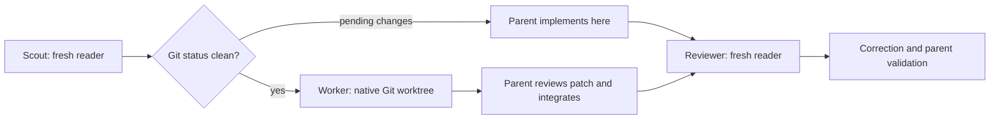

# Execution responsibilities

The parent selects skills, inspects scope and repository state, owns the task board, and accepts work using fresh evidence. Planning and review remain separate requested modes.

Use one writer, at most two independent readers and at most two correction attempts. Oracle may consult with forked conversation context and is not blind review. Native Pi-subagents owns child execution, lifecycle, artifacts and Fleet; the harness owns tasks and questions. Workers run implementation and tests. Parent verification is mandatory. No automatic commit or stash.

Definitions live in [agents](../../agents/worker.md); the behavioral contract lives in [instructions](../../instructions/orchestraitor.md). See [native subagents](../subagents.md) for configuration and current acceptance gates. Worktrees separate Git changes and are not file allowlists or an OS sandbox. Nested delegation, automatic watchdog, missions, schedules and external runners remain outside the initial setup.
