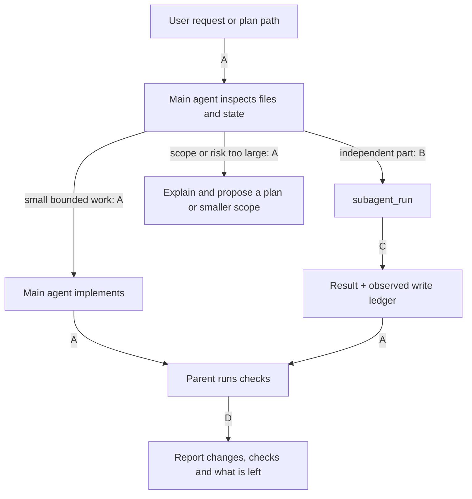
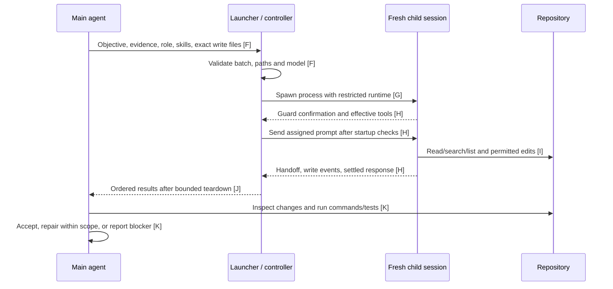

# Who executes, delegates and verifies?

[Component map](index.md) · [Choose a workflow](flows.md)

**The main agent owns execution and acceptance. A child can help; it cannot certify success for its parent.** Every planning route joins this same instructed loop.

## The shared execution loop

Evidence for nodes and edges: **A** [instructions/core.md](../../instructions/core.md); **B** [instructions/core.md](../../instructions/core.md); **C** [extensions/subagents.ts](../../extensions/subagents.ts); **D** [prompts/orchestraitor.md](../../prompts/orchestraitor.md).

A plan file, when given, is read and followed, not rewritten. A failed or skipped check is reported; the agent must not claim completion. The loop is a behavioral contract, **not a controller that advances steps automatically**.

## What actually happens during delegation?

| Evidence | Source |
| --- | --- |
| F | [extensions/subagents.ts](../../extensions/subagents.ts). |
| G | [extensions/subagent/controller.mjs](../../extensions/subagent/controller.mjs), [extensions/subagent/runtime.mjs:7–29](../../extensions/subagent/runtime.mjs). |
| H | [extensions/subagent/controller.mjs](../../extensions/subagent/controller.mjs). |
| I | [extensions/subagent/guard.mjs:13–83](../../extensions/subagent/guard.mjs). |
| J | [extensions/subagent/controller.mjs](../../extensions/subagent/controller.mjs), [extensions/subagents.ts](../../extensions/subagents.ts). |
| K | [instructions/core.md](../../instructions/core.md). |

## Presentation is not acceptance or recovery

The optional [UI](../interactive-ui.md) observes this loop; it does not advance groups. Parent-issued task mutations carry revisions, exact-plan identity/path/hash/groups and evidence for done/reasons for reopening. Only successful native branch receipts are replayed. Child progress travels through native tool updates without adding usage again. Questions collect requirements/preferences, never native trust or destructive-action permission. Hiding chrome does not cancel execution or foreground questions.

## One example, two ways to execute a group

Suppose a request says: reject empty checkout in `src/cart.ts`, with tests in `tests/cart.test.ts`.

| Mode | Walkthrough |
| --- | --- |
| Direct | Parent reads both files, observes a suitable failing test, implements the rejection and reruns checks. |
| Delegated | Parent can ask two readers to inspect code/tests, **or** assign one writer those two exact files. The parent still runs the tests and inspects the actual diff. Readers and writer are separate batches. |

For deterministic behavior tests, observe failure before the fix and success afterward. If that sequence is inappropriate, explain why and use a proportionate check. A final green diff alone does not prove RED/GREEN ([instructions/core.md](../../instructions/core.md)).

## Boundaries worth remembering

- No dedicated persistent planner, executor or verifier agents: these are responsibilities of the main session. Children are fresh, bounded workers.
- Children get selected skills and permitted project instructions, **not the entire parent's conversation or full harness resources** ([extensions/subagents.ts](../../extensions/subagents.ts), [runtime:13–25](../../extensions/subagent/runtime.mjs)).
- Children cannot use Bash, Git, MCP, codemode or nested delegation. Harness resource directories are protected against child writes; the parent handles those changes directly ([subagent policy:1–102](../../extensions/subagent/policy.mjs)).
- One active batch of up to ten readers or ten writers; the active profile limits how many run at once, and each task has its role's time limit. Cancellation preserves partial writes; there is no automatic rollback or durable cross-session recovery ([docs/subagents.md](../subagents.md)).
- `status: completed` means the child finished, not that its work passed acceptance. The parent verifies, and must not call that independent or blind review ([instructions/core.md](../../instructions/core.md)).
- Commits require an explicit current user instruction; execution defaults to unstaged working-tree changes ([instructions/core.md](../../instructions/core.md)).

For tool schemas, lifecycle edge cases and accounting, continue to [Bounded subagents](../subagents.md). That reference is intentionally separate from this quick guide.
